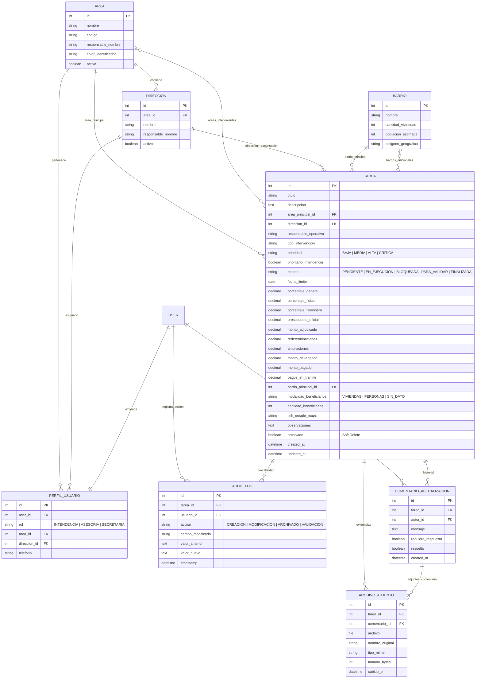

# 🗄️ 02 - Modelo de Datos y Entidades
#base-de-datos #modelos #orm #django #diagrama

Detalle de la estructura relacional de la base de datos, tipos de datos, relaciones e integridad referencial.

Vínculos: [[01 - Arquitectura y Tecnologías]] | [[03 - Jerarquía Organizativa y Permisos]] | [[05 - Reglas de Negocio y Fórmulas]]

---

## 📊 Diagrama Entidad - Relación (ERD)

---

## 📋 Detalle de Modelos

### 1. `Area`
Representa los ministerios, secretarías u órganos superiores de la estructura municipal.
- `nombre`: CharField(150), unique=True.
- `codigo`: CharField(20), unique=True (ej. `SEC_OBRAS`, `SEC_HACIENDA`).
- `responsable_nombre`: CharField(150), persona a cargo del área.
- `color_identificador`: CharField(7), default=`#338c33` (Hexadecimal).
- `activo`: BooleanField(default=True).

### 2. `Direccion`
Dependencias y sub-áreas dependientes de una Secretaría.
- `area`: ForeignKey(Area, on_delete=models.CASCADE, related_name='direcciones').
- `nombre`: CharField(150).
- `responsable_nombre`: CharField(150).
- `activo`: BooleanField(default=True).

### 3. `PerfilUsuario` (Extensión de `auth.User`)
Gestiona el perfil y ámbito de acción de los usuarios en el sistema.
- `user`: OneToOneField(User, on_delete=models.CASCADE).
- `rol`: CharField(choices=[`INTENDENCIA`, `ASESORIA`, `SECRETARIA`]).
- `area`: ForeignKey(Area, null=True, blank=True, on_delete=models.SET_NULL).
- `direccion`: ForeignKey(Direccion, null=True, blank=True, on_delete=models.SET_NULL).

### 4. `Barrio`
Catastro municipal de zonas urbanas y periurbanas de Malagueño.
- `nombre`: CharField(120), unique=True.
- `cantidad_viviendas`: PositiveIntegerField(default=0).
- `poblacion_estimada`: PositiveIntegerField(default=0).
- `poligono_geografico`: JSONField(null=True, blank=True).

### 5. `Tarea`
Núcleo operativo del sistema.
- **Relaciones:** `area_principal` (FK Area), `direccion` (FK Direccion opcional), `areas_intervinientes` (ManyToMany Area), `barrio_principal` (FK Barrio), `barrios_adicionales` (ManyToMany Barrio).
- **Control & Estado:** `estado` (PENDIENTE, EN_EJECUCION, BLOQUEADA, PARA_VALIDAR, FINALIZADA), `prioridad` (BAJA, MEDIA, ALTA, CRITICA), `prioritario_intendencia` (Boolean), `archivado` (Boolean, soft delete).
- **Métricas de Avance:** `porcentaje_general`, `porcentaje_fisico`, `porcentaje_financiero` (DecimalField 0-100).
- **Financiero:** `presupuesto_oficial`, `monto_adjudicado`, `redeterminaciones`, `ampliaciones`, `monto_devengado`, `monto_pagado`, `pagos_en_tramite`.
- **Beneficiarios:** `modalidad_beneficiarios` (`VIVIENDAS`, `PERSONAS`, `SIN_DATO`), `cantidad_beneficiarios`.
- **Ubicación:** `link_google_maps` (URLField).
- **Trazabilidad:** `created_at`, `updated_at`.

### 6. `ComentarioActualizacion`
Seguimiento temporal con línea de tiempo y requerimientos pendientes.
- `tarea`: ForeignKey(Tarea, on_delete=models.CASCADE, related_name='comentarios').
- `autor`: ForeignKey(User, on_delete=models.PROTECT).
- `mensaje`: TextField.
- `requiere_respuesta`: BooleanField(default=False).
- `resuelto`: BooleanField(default=False).

### 7. `ArchivoAdjunto`
Adjuntos multimedia asociados a la tarea o comentario (máximo 40MB).
- `tarea`: ForeignKey(Tarea, on_delete=models.CASCADE, related_name='archivos').
- `comentario`: ForeignKey(ComentarioActualizacion, null=True, blank=True, on_delete=models.SET_NULL).
- `archivo`: FileField(upload_to='seguimiento/%Y/%m/').
- `nombre_original`: CharField(255).
- `tamano_bytes`: PositiveIntegerField.

### 8. `AuditLog`
Historial inmutable de auditoría para asegurar la trazabilidad de cualquier cambio.
- `tarea`: ForeignKey(Tarea, on_delete=models.CASCADE, related_name='auditorias').
- `usuario`: ForeignKey(User, null=True, on_delete=models.SET_NULL).
- `accion`: CharField(50).
- `campo_modificado`: CharField(100).
- `valor_anterior`: TextField(null=True).
- `valor_nuevo`: TextField(null=True).
- `timestamp`: DateTimeField(auto_now_add=True).

