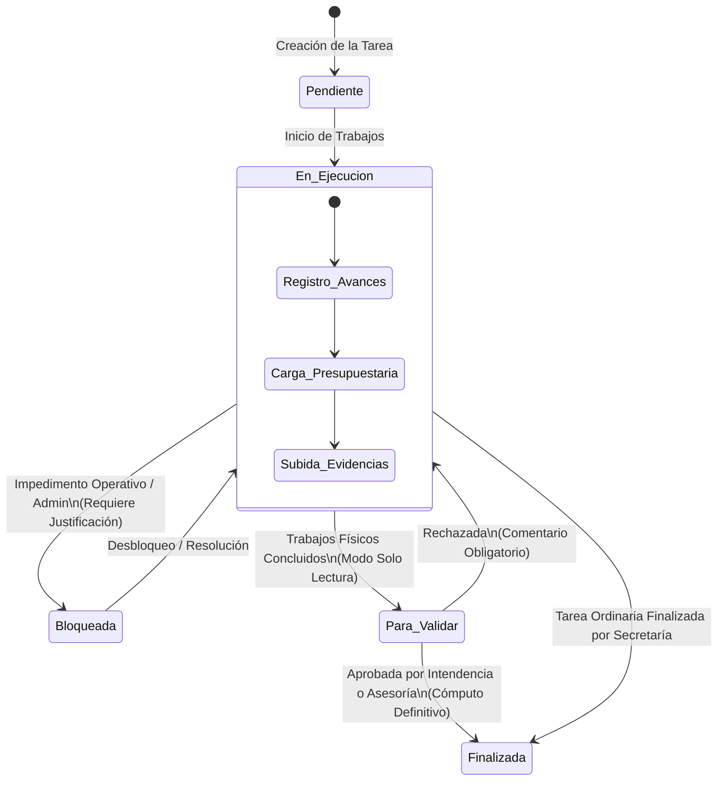

# 🔄 04 - Flujo de Trabajo y Ciclo de Vida de Tareas
#workflow #estados #ciclo-de-vida #validaciones #tareas

Definición de los estados operativos de una tarea, transiciones permitidas, reglas de bloqueo, validación jerárquica y cálculo dinámico de vencimientos.

Vínculos: [[00 - Tablero General (Home)]] | [[02 - Modelo de Datos y Entidades]] | [[03 - Jerarquía Organizativa y Permisos]]

---

## 🧭 Diagrama de Estados y Transiciones

---

## 📌 Definición de Estados

### 1. `Pendiente`
- **Condición:** La tarea fue planificada y asignada, pero aún no se inició la ejecución formal ni se han devengado fondos.
- **Acciones:** Asignación de responsables, carga inicial de presupuesto oficial y fijación de fecha límite.

### 2. `En Ejecución`
- **Condición:** Obra o gestión en curso activo.
- **Acciones:**
  - Carga periódica de avances (% General, % Físico, % Financiero).
  - Imputación de movimientos financieros (Adjudicado, Devengado, Pagado).
  - Subida de evidencias multimedia (fotos, planos, certificaciones).

### 3. `Bloqueada` (Estado Transitorio)
- **Condición:** La tarea sufre un impedimento operativo, judicial, administrativo o presupuestario que detiene los trabajos.
- **Regla Estricta:** Es **obligatorio** documentar la causa del bloqueo en el campo `observaciones`. El sistema impedirá guardar el cambio de estado si el campo se encuentra vacío.

### 4. `Para Validar`
- **Condición:** La Secretaría completó los trabajos físicos y administrativos y eleva la tarea a consideración superior.
- **Regla de Bloqueo:** La tarea entra en **modo de solo lectura** para la Secretaría promotora. Queda inmutable hasta que sea revisada.

### 5. `Finalizada`
- **Condición:** Cierre formal y definitivo del proyecto.
- **Reglas:**
  - Si es ordinaria: Puede cerrarla la propia Secretaría o Asesoría/Intendencia.
  - Si tiene el flag `prioritario_intendencia = True`: **Únicamente Intendencia** puede confirmarla como Finalizada.
  - Pasa al balance final y cómputo de métricas consolidadas.

---

## ⚠️ Regla Especial: Estado Calculado "Vencida"

> [!WARNING] Vencida NO es un estado almacenable
> `Vencida` no existe como opción en el desplegable de estados de la base de datos para evitar desincronizaciones.

- **Fórmula de cálculo:**
  $$\text{Es Vencida} \iff (\text{fecha\_limite} < \text{hoy}) \land (\text{estado} \neq \text{FINALIZADA}) \land (\text{archivado} = \text{False})$$
- Se evalúa dinámicamente en los properties del modelo `Tarea`, en las queries ORM (`views.py`) y en las directivas de plantilla para renderizar el badge rojo de alerta.

---

## ⚖️ Procedimiento de Validación y Rechazo

1. **Elevación:** La Secretaría cambia el estado a `PARA_VALIDAR`.
2. **Revisión:**
   - Si la tarea **no** es prioritaria de Intendencia: Puede ser aprobada por Asesoría Técnica o Intendencia.
   - Si la tarea **es** prioritaria de Intendencia: Solo el usuario con rol `INTENDENCIA` puede validarla.
3. **Decisión:**
   - **Aprobada:** El estado pasa a `FINALIZADA`.
   - **Rechazada:** El estado regresa automáticamente a `EN_EJECUCION`. Se despliega un formulario que obliga al revisor a ingresar un comentario justificando los motivos del rechazo (falta de documentación, obra incompleta, discrepancia financiera).

