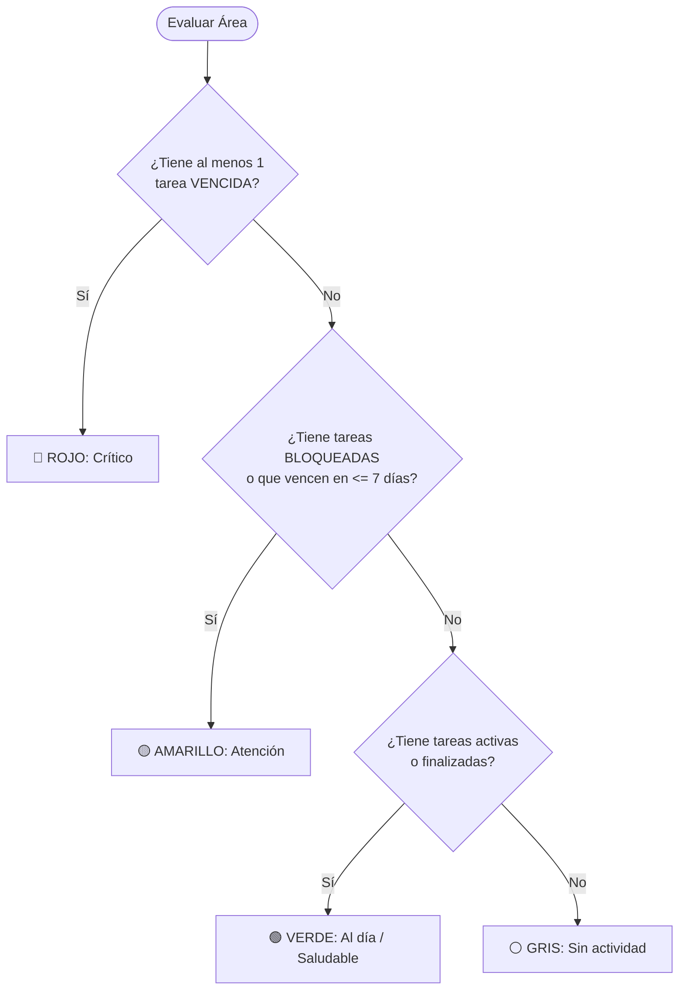

# 📐 05 - Reglas de Negocio y Fórmulas
#reglas-negocio #formulas #finanzas #semaforo #territorio

Fórmulas matemáticas, algoritmos de cálculo financiero, lógica de impacto barrial y reglas de salud operativa para el sistema.

Vínculos: [[00 - Tablero General (Home)]] | [[02 - Modelo de Datos y Entidades]] | [[04 - Flujo de Trabajo y Ciclo de Vida de Tareas]]

---

## 💰 1. Control Presupuestario y Financiero

Las magnitudes presupuestarias de cada tarea se rigen por las siguientes identidades contables:

### 1.1. Monto Contractual Actualizado ($MCA$)
Representa el monto total vigente del contrato, contemplando variaciones de costos y ampliaciones de obra:
$$MCA = \text{Monto Adjudicado} + \text{Redeterminaciones} + \text{Ampliaciones}$$

### 1.2. Devengado Pendiente de Pago ($DPP$)
Monto certificado o comprometido administrativamente pero aún no liquidado efectivamente:
$$DPP = \max(0, \; \text{Monto Devengado} - \text{Monto Pagado})$$

### 1.3. Avance Financiero Porcentual ($AF_\%$)
Tasa de ejecución financiera real sobre el contrato actualizado:
$$AF_\% = \begin{cases} 
\left( \dfrac{\text{Monto Pagado}}{MCA} \right) \times 100 & \text{si } MCA > 0 \\ 
0 & \text{si } MCA = 0 
\end{cases}$$

### 1.4. Validaciones Estrictas de Consistencia Contable
El modelo y los formularios aplicarán las siguientes restricciones de validación:
1. $\text{Monto Pagado} \le \text{Monto Devengado}$
2. $\text{Monto Devengado} \le MCA$
3. $\text{Monto Adjudicado} \ge 0, \quad \text{Redeterminaciones} \ge 0, \quad \text{Ampliaciones} \ge 0$

---

## 📍 2. Impacto Territorial y Beneficiarios

Para evitar la duplicación contable de partidas en el presupuesto municipal, la imputación espacial sigue las siguientes normas:

### 2.1. Criterio de Imputación de Inversión
- **Barrio Principal:** Absorbe el **100%** del monto de la tarea en los cálculos de inversión acumulada por barrio.
- **Barrios Adicionales / Colindantes:** Se registran con fines de impacto de cobertura comunitaria, pero computan **$0** en las sumatorias de inversión territorial para prevenir distorsión estadística.

### 2.2. Modalidades de Estimación de Beneficiarios

| Modalidad | Campo de Entrada | Algoritmo de Cálculo de Habitantes Impactados |
| :--- | :--- | :--- |
| **Viviendas** | Número de viviendas beneficiadas | $\text{Beneficiarios} = \text{Viviendas} \times 3.5$ (Factor INDEC Malagueño) |
| **Personas** | Número directo de personas | $\text{Beneficiarios} = \text{Valor ingresado directamente}$ |
| **Sin Dato** | N/A (Tareas administrativas/legales) | $\text{Beneficiarios} = 0$ |

---

## 🚦 3. Motor del Semáforo de Salud Operativa

Cada Secretaría o Dirección recibe un color de semáforo calculado en tiempo real que refleja su nivel de cumplimiento:

### Tabla Resumen de Criterios de Salud

| Estado Semáforo | Código Hex | Condición Lógica | Significado Operativo |
| :--- | :---: | :--- | :--- |
| **🔴 Rojo** | `#dc2626` | $\exists \text{ tarea activa con } \text{fecha\_limite} < \text{hoy}$ | Situación crítica; incumplimiento de plazos fijados |
| **🟡 Amarillo** | `#eab308` | Sin vencidas, pero con $\text{estado} = \text{BLOQUEADA}$ o $\text{fecha\_limite} \le \text{hoy} + 7\text{ días}$ | Alerta preventiva; requiere gestión de destrabe o celeridad |
| **🟢 Verde** | `#338c33` | Sin vencidas ni alertas; tareas en curso regular o finalizadas | Cumplimiento óptimo de cronograma y gestión |
| **⚪ Gris** | `#9ca3af` | Total de tareas asociadas = 0 | Área o Dirección sin proyectos asignados |

