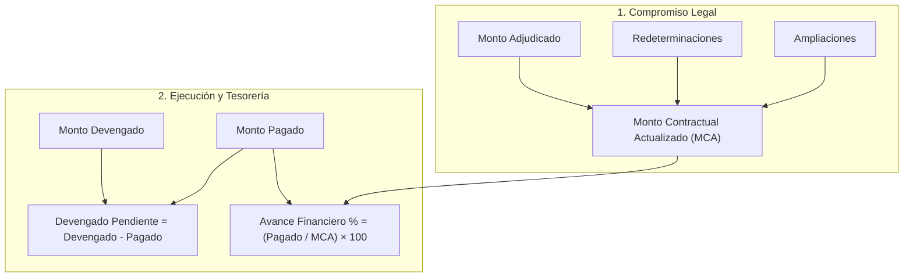

# Guía Explicativa: Matriz Económica y Gestión de Montos Presupuestarios
**Tablero de Control de Gestión · Municipalidad de Malagueño**

---

## 1. Propósito y Enfoque Contable Municipal

El módulo financiero del sistema distingue de manera rigurosa las distintas etapas por las que atraviesa el gasto público municipal en obras, servicios y adquisiciones:

```
[Estimación Inicial] ──> [Compromiso Legal] ──> [Devengado / Certificación] ──> [Pago Efectivo]
```

Esta separación evita los errores habituales de confundir el monto de una licitación con lo efectivamente pagado o devengado, garantizando a Intendencia y a las Secretarías una visión certera del flujo de fondos y de la deuda flotante en tiempo real.

---

## 2. Definición Campo por Campo

### A. Etapa Licitatoria y Contractual

| Campo | Concepto | Cuándo se utiliza |
| :--- | :--- | :--- |
| **Presupuesto Oficial** | Estimación económica inicial establecida en los pliegos de bases y condiciones de la licitación o concurso. | Es un valor de referencia histórico. No obliga legalmente al municipio ni suma al compromiso contractual. |
| **Monto Adjudicado** | Monto formal del contrato firmado o de la orden de compra emitida al proveedor o contratista adjudicado. | Base legal de la contratación original. |
| **Redeterminaciones** | Ajustes de precios reconocidos formalmente por variación de costos (inflación de materiales, mano de obra, combustible). | Se suma cuando se aprueba un decreto o resolución de redeterminación de precios. |
| **Ampliaciones** | Adicionales de obra o ítems complementarios autorizados que incrementan el alcance físico original. | Se suma cuando se aprueba una adenda o ampliación formal de contrato. |

---

### B. Etapa de Ejecución y Tesorería

| Campo | Concepto | Cuándo se utiliza |
| :--- | :--- | :--- |
| **Monto Devengado** | Obligación de pago legalmente perfeccionada (certificados de obra aprobados por inspección técnica, facturas conformadas o actas de recepción de bienes). | Representa deuda líquida y exigible para el municipio, independientemente de si ya salió el dinero de la cuenta bancaria. |
| **Monto Pagado** | Egresos reales y efectivos transferidos al proveedor desde Tesorería (transferencia bancaria, cheque cobrado). | Es el dinero efectivamente desembolsado por la Municipalidad. |
| **Pagos en Trámite** | Facturas o certificados que ya tienen orden de pago generada o expediente en Contaduría/Tesorería, pero cuyo dinero aún no impactó en la cuenta del contratista. | Previsión de caja inmediata a corto plazo (1 a 15 días). |

---

## 3. Fórmulas y Cálculos Automáticos del Sistema

El sistema calcula de manera continua y en tiempo real tres indicadores clave:



### 1. Monto Contractual Actualizado (MCA)
Es el valor total del compromiso económico asumido por el Municipio con todas sus adecuaciones vigentes:
$$\text{MCA} = \text{Monto Adjudicado} + \text{Redeterminaciones} + \text{Ampliaciones}$$

> **Nota:** El MCA es el valor que se imputa en la **matriz de inversión del barrio principal** y en los totales del panel ejecutivo.

### 2. Devengado Pendiente de Pago (Deuda Flotante)
Indica cuántos certificados o bienes ya fueron recibidos y aprobados pero aún no han sido cancelados por Tesorería:
$$\text{Devengado Pendiente} = \text{Monto Devengado} - \text{Monto Pagado}$$

### 3. Porcentaje de Avance Financiero
Mide el porcentaje del contrato que ya fue cancelado financieramente:
$$\text{Avance Financiero (\%)} = \left(\frac{\text{Monto Pagado}}{\text{MCA}}\right) \times 100$$

---

## 4. Semáforo Comparativo: Avance Físico vs. Avance Financiero

El sistema compara en tiempo real el **Avance Físico (%)** ingresado por el inspector de obra contra el **Avance Financiero (%)** calculado:

| Situación | Diagnóstico del Sistema |
| :--- | :--- |
| **Avance Físico > Avance Financiero** | **Saludable / Favorable para el Municipio.** La obra avanzó en territorio más rápido de lo que se ha desembolsado financieramente. |
| **Avance Físico ≈ Avance Financiero** | **Equilibrio Operativo.** Los pagos acompañan al ritmo de la obra de forma regular. |
| **Avance Financiero > Avance Físico** | **Alerta Financiera.** Se ha pagado más de lo que está ejecutado en calle (posible anticipo financiero pendiente de amortizar o demora en obra). |

---

## 5. Reglas de Validación y Consistencia Contable

Para asegurar la integridad de los datos en las auditorías de Intendencia:

1. **Regla de No Superación:**
   $$\text{Monto Pagado} \le \text{Monto Devengado} \le \text{MCA}$$
   El formulario no permite guardar si el monto pagado supera al devengado, impidiendo inconsistencias contables en las declaraciones juradas del sistema.
2. **Flexibilidad Operativa (Campos Opcionales):**
   Las tareas administrativas, programas sociales o actividades comunitarias que no administren partidas monetarias pueden dejarse vacías; el sistema les asigna automáticamente `$ 0,00` sin trabar la carga.
3. **Cero Duplicación Barrial:**
   El presupuesto total (MCA) se asocia **únicamente al Barrio Principal**. Si una obra beneficia a varios barrios vecinos, estos se seleccionan en *"Barrios adicionales"* para fines estadísticos territoriales sin duplicar los montos en los balances consolidados.

---

## 6. Caso Práctico Numérico

A modo de ejemplo ilustrativo, una obra cargada con los siguientes valores:

- **Presupuesto Oficial:** `$ 45.000.000,00`
- **Monto Adjudicado:** `$ 42.000.000,00`
- **Redeterminaciones:** `$ 5.000.000,00`
- **Ampliaciones:** `$ 3.000.000,00`
- **Monto Devengado:** `$ 30.000.000,00`
- **Monto Pagado:** `$ 22.500.000,00`
- **Pagos en Trámite:** `$ 4.500.000,00`
- **Avance Físico:** `65,00 %`

### Resultados Automáticos Generados:
- **MCA:** `$ 50.000.000,00`
- **Devengado Pendiente:** `$ 7.500.000,00`
- **Avance Financiero:** `45,00 %`
- **Diagnóstico:** Obra con balance favorable para el Municipio (65% físico vs. 45% financiero).

